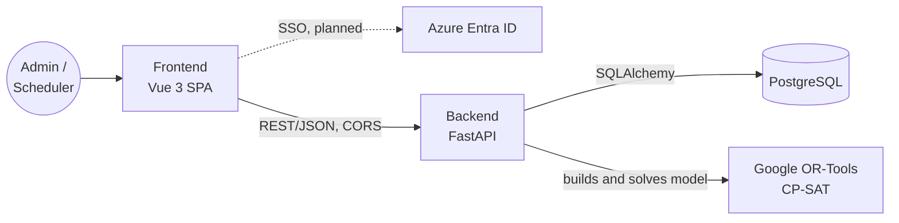

# Architecture

## Overview



## Tech stack

| Layer | Technology | Role |
| --- | --- | --- |
| Frontend | Vue 3, Vite, Vue Router, Pinia, GSAP | Admin UI for reference data and CBA rules; scheduler UI for demand, leave, solver runs, and assignments. See [frontend.md](frontend.md) |
| Auth | Hardcoded demo users today; Azure Entra ID (stub) | Four roles: `admin` (manager), `scheduler`, `rep` (team member), and `viewer`. Admins can also use scheduler pages |
| API | Python 3.12, FastAPI, Uvicorn | REST endpoints, request validation (Pydantic), solver orchestration |
| Optimization | Google OR-Tools CP-SAT | Constraint programming solver that assigns reps to MRO requests |
| Persistence | PostgreSQL 16, SQLAlchemy 2, psycopg2 | Reps, certifications, MRO locations, aircraft types, assignments |
| Packaging | Docker | Backend image (Python 3.12 slim) and frontend image (Node 24 LTS build, unprivileged nginx on port 8080) |
| Hosting (frontend) | nginx container or Azure Static Web Apps | SPA fallback and security headers in `nginx.conf` or `public/staticwebapp.config.json` |

## Repository layout

```text
hackathon/
├── frontend/   Vue 3 + Vite SPA, Dockerfile, nginx.conf (see frontend.md)
├── backend/    FastAPI app: routers/, services/solver.py, models, schemas, Dockerfile
├── db/         init.sql schema and setup instructions
├── docs/       architecture, frontend, API reference, problem statement
└── Makefile    install, dev, lint, database, and Docker targets
```

## Frontend

The frontend is a single-page app. It has a public home page and login page, plus two role-gated areas:

| Area | Role | Pages |
| --- | --- | --- |
| `/admin` | `admin` | Overview, tech reps and certifications, roster (monthly grid by rep in seniority order, colored by MRO and leave, with inductions and RTS per aircraft type), aircraft types, MRO locations and travel times, CBA rules, holidays and pay periods |
| `/scheduler` | `scheduler` (or `admin`) | Overview, MRO demand, rep unavailability, run scheduler, assignments |
| `/dashboards` | Per page | Workforce, Coverage, and Vacation (all roles; vacation balances only for `admin`, and for a `rep` their own); Training (`admin`, `rep`); Alerts (`admin`, `scheduler`) |

The browser calls the API directly at `VITE_API_BASE_URL`, so that origin must be listed in the backend `CORS_ORIGINS` setting. `VITE_*` values are baked into the bundle at build time and must not hold secrets. For the full structure, see [frontend.md](frontend.md).

> The API does not check tokens yet. Until Azure SSO is wired up on both sides, the role checks in the UI only hide pages; they do not protect data.

## Backend endpoints

For inputs, outputs, and examples, see [api_route_reference.md](api_route_reference.md).

| Method | Path | Description |
| --- | --- | --- |
| GET | `/health` | Liveness check |
| GET | `/reps` | List Tech Reps with their certified aircraft type IDs |
| GET | `/reps/{rep_id}` | Get one Tech Rep |
| POST | `/reps` | Create a Tech Rep and their certifications |
| PATCH | `/reps/{rep_id}` | Update rep fields (only fields sent change) |
| GET | `/reps/{rep_id}/certifications` | List a rep's certifications |
| PUT, DELETE | `/reps/{rep_id}/certifications/{aircraft_type_id}` | Add or update, or remove, a certification with its dates |
| GET, POST | `/aircraft-types`, GET, PATCH `/aircraft-types/{id}` | Aircraft types |
| GET, POST | `/mro-locations`, GET, PATCH `/mro-locations/{id}` | MRO facilities. `timezone` must be an IANA name |
| GET | `/mro-locations/{id}/travel-times` | One-way travel times to this MRO |
| PUT, DELETE | `/mro-locations/{id}/travel-times/{home_base}` | Set or remove travel from a home base |
| GET | `/cba/rules`, `/cba/rules/active` | CBA limits (all, or the set in effect on `?on=`) |
| PATCH | `/cba/rules/{id}` | Update a CBA rule set (only fields sent change) |
| GET | `/cba/shift-patterns` | Shift patterns with their start-time windows |
| GET, POST | `/cba/holidays` | Statutory holidays |
| GET, POST | `/cba/pay-periods`, DELETE `/cba/pay-periods/{id}` | Pay periods for the overtime tier |
| GET, POST | `/unavailability` | Rep vacation, sick, training, and leave. `PATCH /unavailability/{id}` changes status |
| GET, POST | `/demands` | MRO demand. `PATCH /demands/{id}` changes status |
| GET | `/demands/{id}/responses` | Solicitation replies for a demand |
| PUT, DELETE | `/demands/{id}/responses/{rep_id}` | Record or remove a rep's accept or decline |
| GET, POST | `/assignments`, GET `/assignments/{id}` | List with filters, or create a manual override. Saved even when it breaks a rule; compliance findings come back as warnings and alerts |
| PATCH | `/assignments/{id}` | Change status (proposed to confirmed to in_progress to completed; any live status to cancelled), rep, or times, with compliance warnings |
| POST | `/schedule/run` | Solve open demands in a window of up to 366 days. `save: true` stores proposals, approves granted vacation requests, runs compliance, and scans for coverage alerts |
| POST | `/schedule/solve` | Placeholder CP-SAT model that takes its input in the request body |
| GET, PUT | `/cba/sick-leave-allowance` | Sick days allowed from each month to year end |
| * | `/training/...` | Training types and records; approve or reject submitted dates; `/training/due` |
| * | `/leave-balances` | Vacation, stat, and sick balances per rep and year |
| * | `/vacation/...` | Bids (CRUD and CSV import), `/vacation/award` by seniority, `/vacation/capacity` per week |
| * | `/maintenance-events` | HMS and unplanned events (CRUD and CSV import); generate and update demands; `/{id}/staffing-options` |
| GET | `/overtime/opportunities` | Unfilled demand with eligible reps by seniority |
| * | `/alerts` | Alert feed by location, acknowledge, and `/alerts/scan` |
| GET | `/dashboards/workforce`, `/dashboards/coverage` | Dashboard data |
| GET | `/docs` | Auto-generated OpenAPI UI |

## Solver flow

`POST /schedule/run` ([services/scheduler.py](../backend/services/scheduler.py)):

1. Load the CBA rules in effect, open demands in the window, active reps with certifications and shift patterns, approved unavailability, existing assignments (back to the start of each averaging and pay period), solicitation responses, travel times, pay periods, and holidays.
2. Build a CP-SAT model with `x[rep, demand]` booleans for eligible pairs only:
   - Eligibility: a valid certification, no approved unavailability, no clash with existing assignments including travel and minimum rest, and on-site hours plus travel within the 16 h duty day (21-1.03).
   - Hard constraints: `reps_needed` per demand, no overlap and minimum rest between new assignments, max consecutive worked days, a run of 3 days off in every 28 for 5-5-4 reps (19-1.07), and regular hours within the 40 h weekly average over 26 or 52 weeks (19-1.01 to 19-1.03) for reps without a shift pattern.
   - Mandatory work: once a demand has `demand_responses`, reps who did not accept are assigned only when `allow_mandatory` is true, in reverse Union Seniority (16-1.06, 21-2.09, 21-3.08), at 2x.
   - Objective, in strict order: fill higher-priority demands, prefer volunteers, follow reverse seniority, then minimize premium pay. Premium covers overtime (1.5x for the first 8 h per pay period, then 1.75x, per 16-1.04), field service at 1.5x including travel (21-2.02), AOG with 2 h buffers each side (21-3.02), and statutory holidays, with no duplication (16-1.05).
3. Solve with a time limit.
4. With `save: true`, write results to `assignments` with `status = 'proposed'`, plus overtime type, overtime hours, and travel hours. Unfilled demands come back with a reason, and data gaps (such as a missing travel time) come back as warnings.
5. A scheduler reviews the proposals on the Assignments page and confirms them one at a time or all at once. This moves the status to `confirmed`. The same page also starts, completes, and cancels assignments.

Not modeled yet: Base Coverage and AOG list membership and rotation (21-2.03 to 21-2.07, 21-3.04 to 21-3.07), the 48 h minimum per set of days off (19-1.07), and banked overtime (15-4).

Additions for workforce planning:

- **Approved training** blocks reps like approved leave.
- **Vacation cap.** Each `requested` vacation entry in the window gets a boolean. Per Monday-start week, reps on approved vacation plus granted requests stay within `max_reps_off_per_week` (hard constraint). A granted request blocks overlapping work. Grants carry the top objective weight ($10^{13}$), minus a seniority step, so requests are granted whenever the cap allows, most senior first.
- **Continuity.** Each pair earns up to `CONTINUITY_WEIGHT` = $10^6$ times the rep's share of worked days at that MRO in the last `continuity_lookback_days`. This sits below reverse seniority and above any single assignment's premium cost.
- **Home team.** A rep based at the MRO's `covering_base` (Kelowna for Kelowna, Toronto for the east, Calgary for the rest) earns `HOME_TEAM_WEIGHT` = $10^6$, in the same tier as continuity. Overtime opportunities list that team first, each group in seniority order.
- **Seniority order** uses `seniority_rank`, then `union_seniority_date`.

## Compliance checks

[services/compliance.py](../backend/services/compliance.py) checks one rep around a changed window (21 days either side) and writes findings to `alerts`. It runs after manual assignment create and edit, after a saved schedule run, after leave changes, and after training approval. Findings never block a change. Alerts on checked assignments that no longer apply are acknowledged automatically.

| Type | Check |
| --- | --- |
| `rest` | Gap between shifts under `min_rest_hours` (field service rest when away); fewer than `min_days_off_between_rotations` full days off between runs of worked days; a run longer than `max_consecutive_worked_days`; under `min_hours_off_per_set` free in a set of pattern days off (free days need not be consecutive) |
| `shift_pattern` | `7-7` reps: more than 7 days in a row, or work on a pattern day off |
| `training_conflict`, `vacation_limit`, `sick_limit` | Work overlapping approved training, vacation, or sick leave |
| `training_conflict` | Approved training on shift that takes neither the first nor the last day of the rotation |
| `training_expired` | Mandatory training missing or expired before an assignment |
| `qualification` | No valid certification for the aircraft type on the assignment dates |
| `no_aircraft` | Assignment days at an MRO outside every maintenance event for its aircraft type there (base coverage and AOG demands excepted) |
| `vacation_limit` | Vacation days over the year's vacation plus stat entitlement; the rep is off in a week over `max_reps_off_per_week` |
| `sick_limit` | Sick days from any month to year end over `sick_leave_allowance`; over the year's sick entitlement |
| `seniority` | Voluntary overtime while a more senior rep accepted and is free; mandatory overtime while a more junior rep is free; a vacation week awarded while a more senior rep's bid for it was denied |

## How CP-SAT solves the schedule

Scheduling reps is a combinatorial assignment problem. Every rep and demand pair is a yes or no decision, and the CBA rules link those decisions across days, pay periods, and averaging periods. [Google OR-Tools CP-SAT](https://developers.google.com/optimization/cp/cp_solver) handles this kind of problem well. It works on integer and boolean variables, and it combines constraint propagation, SAT-style clause learning, and linear relaxations. It returns either a proven optimum or the best schedule it found before the time limit.

The model lives in `run()` in [services/scheduler.py](../backend/services/scheduler.py).


### 1. Filter pairs in Python before modeling

The code checks most rules in Python for each candidate pair and only creates a variable when the pair passes. This keeps the model small and lets the API explain why a demand stayed unfilled. A pair is dropped when:

- the rep has no valid certification for the aircraft type
- the demand plus travel exceeds the max duty day (21-1.03)
- the busy window, which is the demand plus travel on each side, overlaps approved unavailability
- the busy window clashes with an existing assignment once minimum rest is added (field service rest when either side is field service)
- the demand was solicited, the rep did not accept, and `allow_mandatory` is false

For each surviving pair the code precomputes fixed values: travel hours, paid hours, pattern overtime hours, flexible hours (for reps without a shift pattern), the fixed premium cost, the busy window, the pay period, and the averaging period.

### 2. Integer units

CP-SAT accepts integer coefficients only, so the model uses:

- hours in hundredths (`HOUR = 100`)
- pay rates in percent (1.5x is `150`)
- premium cost as `(rate - 100) * hundredths`, which is the cost above straight time

### 3. Decision variables

| Variable | Type | Meaning |
|---|---|---|
| `x[rep, demand]` | bool | The rep is assigned to the demand |
| `reg[rep, demand]` | int, 0 to flexible hours | Flexible hours paid as regular time. The rest are overtime |
| `over[rep, pay_period]` | int, 0 or more | Voluntary overtime above the 16-1.04 tier in that pay period |
| `w[rep, day]` | bool | The rep works on that local date |
| `off[rep, start_day]` | bool | The run of days off that starts on that day is fully off |

### 4. Hard constraints

**Coverage.** For each demand, $\sum_r x_{r,d} \le \text{reps\_needed} - \text{already\_filled}$. This is an upper bound, not an equality. A demand that cannot be fully staffed comes back partly filled rather than making the whole model infeasible. The objective pushes coverage up.

**No overlap and minimum rest.** For each rep, every pair of candidate demands whose busy windows are closer than the rest gap gets `AddAtMostOne(x[rep, d1], x[rep, d2])`.

**Regular-hours average (19-1.01 to 19-1.03).** This applies to reps without a shift pattern. Each `reg` is limited to the flexible hours and is zero when the rep is not assigned: $\text{reg}_{r,d} \le \text{flex}_{r,d} \cdot x_{r,d}$. The total per averaging period is capped at

$$\sum_d \text{reg}_{r,d} \le \text{avg\_weekly\_hours} \cdot \frac{\text{days in period}}{7} - \text{existing regular hours}$$

Any flexible hours above the cap are paid as overtime.

**Overtime tier (16-1.04).** For each rep and pay period, the model adds

$$\text{over} \ge \text{existing OT} + \sum \text{new voluntary OT} - \text{tier}, \quad \text{over} \ge 0$$

The objective charges `(ot_over_rate - ot_rate) * over`, so the solver keeps `over` as low as it can. The result is $\max(0, \ldots)$, the hours paid at the higher tier, without a non-linear constraint. Mandatory hours are excluded because they are already paid at the mandatory rate.

**Max consecutive worked days.** Each rep gets a day-by-day `worked_on` list that spans the candidate demands plus a margin on each side. Each entry is one of:

- `1` when the day is already worked: an existing assignment, or a shift pattern work day that is not on leave
- `w[rep, day]` with `AddMaxEquality(w, [x for demands touching that day])` when a new assignment could land on that day
- `0` otherwise

Every sliding window of `max_consecutive + 1` days that contains a variable gets $\sum \text{worked\_on} \le \text{max\_consecutive}$.

**Consecutive days off for 5-5-4 reps (19-1.07).** Each possible run of `off_run` days with no fixed work day gets an `off` boolean. The constraint $\text{off} + w \le 1$ for each day in the run means the run counts as off only when none of its days are worked. Every rolling window of `off_window` days then needs $\sum \text{off} \ge 1$. The constraint is skipped in two cases. If a run in the window is already guaranteed off, the rule is met. If the existing schedule already breaks the rule, adding the constraint would make the model infeasible.

### 5. Objective

CP-SAT optimizes a single linear expression. The code builds one maximized sum with tiered weights so that higher goals dominate lower ones:

| Tier | Weight | Effect |
|---|---|---|
| Coverage by priority | `PRIORITY_WEIGHT * (6 - priority)` = $10^{10}$ to $5 \times 10^{10}$ per seat | Filling a seat beats any combination of the tiers below |
| Volunteer over mandatory | `-MANDATORY_PENALTY` = $-10^9$ | A volunteer is preferred, but a mandatory rep still beats an empty seat |
| Reverse seniority | `-SENIORITY_STEP * rank` = $-10^7$ per rank, rank capped at 50 | The most junior rep is preferred for mandatory work (16-1.06, 21-2.09, 21-3.08) |
| Premium pay | `-fixed_cost`, flexible overtime, and `-(ot_over_rate - ot_rate) * over` | The cheapest schedule wins among otherwise equal options |

Per assignment, the contribution is

$$
x_{r,d} \cdot \big(W_P (6 - p_d) - \text{fixed\_cost} - (\text{flex\_rate} + 1)\,\text{flex}_{r,d} - [\text{mandatory}](W_M + W_S \cdot \text{rank})\big) + (\text{flex\_rate} + 1)\,\text{reg}_{r,d}
$$

Each flexible hour is charged as overtime up front and refunded when the solver classes it as regular through `reg`. The `+1` breaks ties toward regular hours when the overtime rate adds no extra cost, such as on field service, which is paid at its own rate.

Priority weights scale linearly. A priority 1 seat is worth five priority 5 seats, so the solver gives up one priority 1 seat if that fills six or more priority 5 seats.

### 6. Solve

`CpSolver` runs with `max_time_in_seconds = settings.solver_max_seconds` (default 10 s). CP-SAT presolves the model to fix variables and tighten bounds. It then runs a portfolio of parallel workers, including tree search with propagation, large neighbourhood search, and LP-based bounding. Workers share solutions and bounds.

| Status | Meaning |
|---|---|
| `OPTIMAL` | The best schedule, proven |
| `FEASIBLE` | The best schedule found when the time limit ran out |
| `INFEASIBLE`, `MODEL_INVALID`, `UNKNOWN` | No proposals are returned |

Leaving every `x` at 0 meets coverage, rest, and overtime constraints, so CP-SAT usually finds a feasible starting point at once. The time limit controls how long it spends improving that schedule.

### 7. Read the result

Each `x` set to 1 becomes a `ProposedAssignment`. Flexible overtime equals flexible hours minus the solved `reg` value. Premium hours equal the fixed cost plus flexible overtime cost, divided by `100 * HOUR`. Demands with seats left come back as unfilled, with a reason built from the per-pair rejection counts. With `save: true`, proposals are written to `assignments` as `proposed`.

## Running locally

```sh
# Database
docker run -d --name techrep-db -e POSTGRES_USER=techrep -e POSTGRES_PASSWORD=change-me \
  -e POSTGRES_DB=techrep -p 5432:5432 \
  -v "$PWD/db/init.sql:/docker-entrypoint-initdb.d/init.sql:ro" postgres:16

# Backend
cd backend
cp .env.example .env
python3 -m venv .venv && source .venv/bin/activate
pip install -r requirements.txt
uvicorn main:app --reload

# Or run the backend in Docker
docker build -t techrep-backend backend
docker run --rm -p 8000:8000 --env-file backend/.env \
  -e DB_HOST=host.docker.internal techrep-backend

# Frontend (http://localhost:5173)
cd frontend
cp .env.example .env
npm install
npm run dev

# Or build and run the frontend image (http://localhost:8080)
make frontend-docker-build VITE_API_BASE_URL=http://localhost:8000
docker run --rm -p 8080:8080 techrep-frontend
```

`make dev` runs the backend and frontend together. When serving the UI from a different origin, such as port 8080, add that origin to `CORS_ORIGINS` in `backend/.env`.
