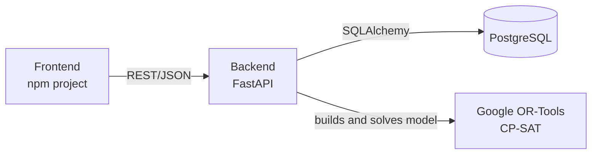

# Architecture

## Overview



## Tech stack

| Layer | Technology | Role |
| --- | --- | --- |
| Frontend | npm project, framework not chosen yet | Scheduler UI: view reps, MRO demand, and proposed schedules |
| API | Python 3.12, FastAPI, Uvicorn | REST endpoints, request validation (Pydantic), solver orchestration |
| Optimization | Google OR-Tools CP-SAT | Constraint programming solver that assigns reps to MRO requests |
| Persistence | PostgreSQL 16, SQLAlchemy 2, psycopg2 | Reps, certifications, MRO locations, aircraft types, assignments |
| Packaging | Docker | Container image for the backend |

## Repository layout

```text
hackathon/
├── frontend/   npm project (UI to be added)
├── backend/    FastAPI app: routers/, services/solver.py, models, schemas, Dockerfile
├── db/         init.sql schema and setup instructions
└── docs/       architecture and problem statement
```

## Backend endpoints

| Method | Path | Description |
| --- | --- | --- |
| GET | `/health` | Liveness check |
| GET | `/reps` | List Tech Reps with their certified aircraft type IDs |
| GET | `/reps/{rep_id}` | Get one Tech Rep |
| POST | `/reps` | Create a Tech Rep and their certifications |
| POST | `/schedule/solve` | Placeholder CP-SAT model that matches requests to certified reps |
| GET | `/docs` | Auto-generated OpenAPI UI |

## Solver flow

1. Load reps, certifications, MRO locations, and open requests from PostgreSQL.
2. Build a CP-SAT model:
   - Decision variables: `x[rep, request]` booleans, plus interval variables for time windows.
   - Hard constraints: certification match, no overlapping assignments per rep (`AddNoOverlap`), availability windows.
   - Objective: maximize coverage, then minimize travel and imbalance between reps.
3. Solve with a time limit.
4. Write results to `assignments` with `status = 'proposed'`.
5. A planner confirms the proposal in the UI, which moves the status to `confirmed`.

Steps 1, 4, and 5 are not implemented yet. The current endpoint takes its input in the request body.

## Running locally

```sh
# Database
docker run -d --name techrep-db -e POSTGRES_USER=techrep -e POSTGRES_PASSWORD=change-me \
  -e POSTGRES_DB=techrep -p 5432:5432 \
  -v "$PWD/db/init.sql:/docker-entrypoint-initdb.d/init.sql:ro" postgres:16

# Backend
cd backend
cp .env.example .env
python3 -m venv .venv && source .venv/bin/activate
pip install -r requirements.txt
uvicorn main:app --reload

# Or run the backend in Docker
docker build -t techrep-backend backend
docker run --rm -p 8000:8000 --env-file backend/.env \
  -e DB_HOST=host.docker.internal techrep-backend
```
