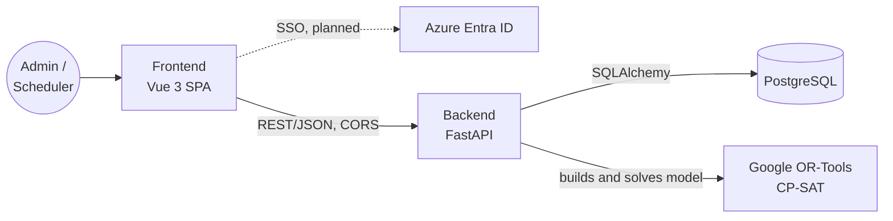

# Architecture

## Overview



## Tech stack

| Layer | Technology | Role |
| --- | --- | --- |
| Frontend | Vue 3, Vite, Vue Router, Pinia, GSAP | Admin UI for reference data and CBA rules; scheduler UI for demand, leave, solver runs, and assignments. See [frontend.md](frontend.md) |
| Auth | Hardcoded demo users today; Azure Entra ID (stub) | Two roles: `admin` and `scheduler`. Admins can also use scheduler pages |
| API | Python 3.12, FastAPI, Uvicorn | REST endpoints, request validation (Pydantic), solver orchestration |
| Optimization | Google OR-Tools CP-SAT | Constraint programming solver that assigns reps to MRO requests |
| Persistence | PostgreSQL 16, SQLAlchemy 2, psycopg2 | Reps, certifications, MRO locations, aircraft types, assignments |
| Packaging | Docker | Backend image (Python 3.12 slim) and frontend image (Node 24 LTS build, unprivileged nginx on port 8080) |
| Hosting (frontend) | nginx container or Azure Static Web Apps | SPA fallback and security headers in `nginx.conf` or `public/staticwebapp.config.json` |

## Repository layout

```text
hackathon/
├── frontend/   Vue 3 + Vite SPA, Dockerfile, nginx.conf (see frontend.md)
├── backend/    FastAPI app: routers/, services/solver.py, models, schemas, Dockerfile
├── db/         init.sql schema and setup instructions
├── docs/       architecture, frontend, API reference, problem statement
└── Makefile    install, dev, lint, database, and Docker targets
```

## Frontend

The frontend is a single-page app. It has a public home page and login page, plus two role-gated areas:

| Area | Role | Pages |
| --- | --- | --- |
| `/admin` | `admin` | Overview, tech reps and certifications, aircraft types, MRO locations and travel times, CBA rules, holidays and pay periods |
| `/scheduler` | `scheduler` (or `admin`) | Overview, MRO demand, rep unavailability, run scheduler, assignments |

The browser calls the API directly at `VITE_API_BASE_URL`, so that origin must be listed in the backend `CORS_ORIGINS` setting. `VITE_*` values are baked into the bundle at build time and must not hold secrets. For the full structure, see [frontend.md](frontend.md).

> The API does not check tokens yet. Until Azure SSO is wired up on both sides, the role checks in the UI only hide pages; they do not protect data.

## Backend endpoints

For inputs, outputs, and examples, see [api_route_reference.md](api_route_reference.md).

| Method | Path | Description |
| --- | --- | --- |
| GET | `/health` | Liveness check |
| GET | `/reps` | List Tech Reps with their certified aircraft type IDs |
| GET | `/reps/{rep_id}` | Get one Tech Rep |
| POST | `/reps` | Create a Tech Rep and their certifications |
| PATCH | `/reps/{rep_id}` | Update rep fields (only fields sent change) |
| GET | `/reps/{rep_id}/certifications` | List a rep's certifications |
| PUT, DELETE | `/reps/{rep_id}/certifications/{aircraft_type_id}` | Add or update, or remove, a certification with its dates |
| GET, POST | `/aircraft-types`, GET, PATCH `/aircraft-types/{id}` | Aircraft types |
| GET, POST | `/mro-locations`, GET, PATCH `/mro-locations/{id}` | MRO facilities. `timezone` must be an IANA name |
| GET | `/mro-locations/{id}/travel-times` | One-way travel times to this MRO |
| PUT, DELETE | `/mro-locations/{id}/travel-times/{home_base}` | Set or remove travel from a home base |
| GET | `/cba/rules`, `/cba/rules/active` | CBA limits (all, or the set in effect on `?on=`) |
| PATCH | `/cba/rules/{id}` | Update a CBA rule set (only fields sent change) |
| GET | `/cba/shift-patterns` | Shift patterns with their start-time windows |
| GET, POST | `/cba/holidays` | Statutory holidays |
| GET, POST | `/cba/pay-periods`, DELETE `/cba/pay-periods/{id}` | Pay periods for the overtime tier |
| GET, POST | `/unavailability` | Rep vacation, sick, training, and leave. `PATCH /unavailability/{id}` changes status |
| GET, POST | `/demands` | MRO demand. `PATCH /demands/{id}` changes status |
| GET | `/demands/{id}/responses` | Solicitation replies for a demand |
| PUT, DELETE | `/demands/{id}/responses/{rep_id}` | Record or remove a rep's accept or decline |
| GET, POST | `/assignments`, GET `/assignments/{id}` | List with filters, or create a manual override (CBA rules not checked) |
| PATCH | `/assignments/{id}` | Change status: proposed to confirmed to in_progress to completed; any live status to cancelled |
| POST | `/schedule/run` | Solve open demands in a time window from database data. `save: true` stores proposals |
| POST | `/schedule/solve` | Placeholder CP-SAT model that takes its input in the request body |
| GET | `/docs` | Auto-generated OpenAPI UI |

## Solver flow

`POST /schedule/run` ([services/scheduler.py](../backend/services/scheduler.py)):

1. Load the CBA rules in effect, open demands in the window, active reps with certifications and shift patterns, approved unavailability, existing assignments (back to the start of each averaging and pay period), solicitation responses, travel times, pay periods, and holidays.
2. Build a CP-SAT model with `x[rep, demand]` booleans for eligible pairs only:
   - Eligibility: a valid certification, no approved unavailability, no clash with existing assignments including travel and minimum rest, and on-site hours plus travel within the 16 h duty day (21-1.03).
   - Hard constraints: `reps_needed` per demand, no overlap and minimum rest between new assignments, max consecutive worked days, a run of 3 days off in every 28 for 5-5-4 reps (19-1.07), and regular hours within the 40 h weekly average over 26 or 52 weeks (19-1.01 to 19-1.03) for reps without a shift pattern.
   - Mandatory work: once a demand has `demand_responses`, reps who did not accept are assigned only when `allow_mandatory` is true, in reverse Union Seniority (16-1.06, 21-2.09, 21-3.08), at 2x.
   - Objective, in strict order: fill higher-priority demands, prefer volunteers, follow reverse seniority, then minimize premium pay. Premium covers overtime (1.5x for the first 8 h per pay period, then 1.75x, per 16-1.04), field service at 1.5x including travel (21-2.02), AOG with 2 h buffers each side (21-3.02), and statutory holidays, with no duplication (16-1.05).
3. Solve with a time limit.
4. With `save: true`, write results to `assignments` with `status = 'proposed'`, plus overtime type, overtime hours, and travel hours. Unfilled demands come back with a reason, and data gaps (such as a missing travel time) come back as warnings.
5. A scheduler reviews the proposals on the Assignments page and confirms them one at a time or all at once. This moves the status to `confirmed`. The same page also starts, completes, and cancels assignments.

Not modeled yet: Base Coverage and AOG list membership and rotation (21-2.03 to 21-2.07, 21-3.04 to 21-3.07), the 48 h minimum per set of days off (19-1.07), and banked overtime (15-4).

## Running locally

```sh
# Database
docker run -d --name techrep-db -e POSTGRES_USER=techrep -e POSTGRES_PASSWORD=change-me \
  -e POSTGRES_DB=techrep -p 5432:5432 \
  -v "$PWD/db/init.sql:/docker-entrypoint-initdb.d/init.sql:ro" postgres:16

# Backend
cd backend
cp .env.example .env
python3 -m venv .venv && source .venv/bin/activate
pip install -r requirements.txt
uvicorn main:app --reload

# Or run the backend in Docker
docker build -t techrep-backend backend
docker run --rm -p 8000:8000 --env-file backend/.env \
  -e DB_HOST=host.docker.internal techrep-backend

# Frontend (http://localhost:5173)
cd frontend
cp .env.example .env
npm install
npm run dev

# Or build and run the frontend image (http://localhost:8080)
make frontend-docker-build VITE_API_BASE_URL=http://localhost:8000
docker run --rm -p 8080:8080 techrep-frontend
```

`make dev` runs the backend and frontend together. When serving the UI from a different origin, such as port 8080, add that origin to `CORS_ORIGINS` in `backend/.env`.
