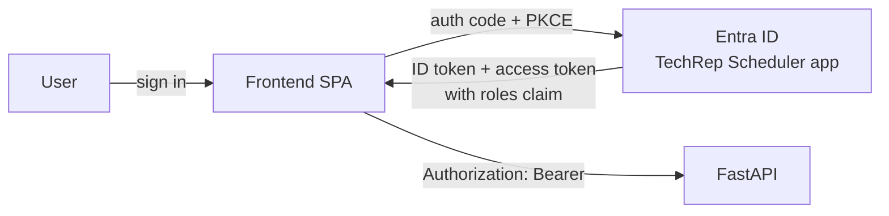

# Azure Entra ID SSO Setup

Set up an Entra ID app registration, define the two app roles, and assign users so the frontend signs in with SSO (`VITE_AUTH_MODE=azure`).

> **Code status:** `frontend/src/auth/azureProvider.js` is still a stub. It maps token claims to UI roles but does not call MSAL yet. The backend does not validate tokens yet. Complete the portal setup below first, then wire up `@azure/msal-browser` and backend token checks (see [Next Steps](#next-steps)).

## Overview



This guide uses **one app registration** for both the SPA and the API. With one registration:

- The `roles` claim appears in both the ID token (read by the UI) and the access token (read by the API).
- You define and assign the roles once.

| Item | Value |
| --- | --- |
| App registration name | `TechRep Scheduler` |
| Platform | Single-page application (SPA) |
| Redirect URI (local) | `http://localhost:5173/auth/callback` |
| Post-logout URI (local) | `http://localhost:5173/` |
| API scope | `api://<client-id>/access_as_user` |
| App role: admin | `TechRep.Admin` |
| App role: scheduler | `TechRep.Scheduler` |

The UI maps roles as follows (see `userFromClaims()` in `frontend/src/auth/azureProvider.js`):

| Entra app role | UI role | Access |
| --- | --- | --- |
| `TechRep.Admin` | `admin` | `/admin` pages and all scheduler pages |
| `TechRep.Scheduler` | `scheduler` | `/scheduler` pages |

A signed-in user with neither role has no UI access.

## Prerequisites

- Access to the [Microsoft Entra admin center](https://entra.microsoft.com).
- One of these roles in the tenant:
  - **Application Developer** to create the registration.
  - **Cloud Application Administrator** (or owner of the enterprise app) to assign users and grant admin consent.
- **Entra ID P1 or P2** if you want to assign **groups** to roles. The free tier only supports assigning individual users.

## 1. Create the App Registration

1. Go to **Entra ID > App registrations > New registration**.
2. **Name:** `TechRep Scheduler`.
3. **Supported account types:** *Accounts in this organizational directory only (Single tenant)*.
4. **Redirect URI:** select platform **Single-page application (SPA)** and enter `http://localhost:5173/auth/callback`.
5. Select **Register**.
6. On the **Overview** page, copy:
   - **Application (client) ID** - used for `VITE_AZURE_CLIENT_ID`.
   - **Directory (tenant) ID** - used for `VITE_AZURE_TENANT_ID`.

> Pick **SPA**, not **Web**. A Web platform redirect fails with `AADSTS9002326` because the browser cannot redeem the code cross-origin.

## 2. Configure Authentication

Go to **Authentication**.

1. Under **Single-page application > Redirect URIs**, add one URI per environment:
   - `http://localhost:5173/auth/callback`
   - `https://<your-frontend-host>/auth/callback`
2. **Front-channel logout URL:** `https://<your-frontend-host>/` (optional).
3. Under **Implicit grant and hybrid flows**, leave both boxes **unchecked**. MSAL uses the auth code flow with PKCE.
4. Select **Save**.

Non-localhost redirect URIs must use `https`.

## 3. Expose the API Scope

Go to **Expose an API**.

1. Next to **Application ID URI**, select **Add** and accept `api://<client-id>`. Select **Save**.
2. Select **Add a scope**:

   | Field | Value |
   | --- | --- |
   | Scope name | `access_as_user` |
   | Who can consent | Admins and users |
   | Admin consent display name | `Access TechRep Scheduler API` |
   | Admin consent description | `Allows the app to call the TechRep Scheduler API as the signed-in user.` |
   | State | Enabled |

3. Select **Add scope**. The full scope is `api://<client-id>/access_as_user`.

Then set the access token version to v2 so the backend validates a single issuer format:

1. Go to **Manifest**.
2. Set `"requestedAccessTokenVersion": 2` (in the `api` section of the Microsoft Graph manifest, or `accessTokenAcceptedVersion` in the legacy AAD Graph manifest).
3. Select **Save**.

## 4. Add API Permissions

Go to **API permissions**.

1. Keep **Microsoft Graph > User.Read** (added by default).
2. Select **Add a permission > My APIs > TechRep Scheduler > Delegated permissions**, check `access_as_user`, and select **Add permissions**.
3. Select **Grant admin consent for <tenant>** and confirm. Both rows show a green check.

Admin consent stops each user from seeing a consent prompt on first sign-in.

## 5. Create the App Roles

Go to **App roles > Create app role** and add two roles:

| Field | Admin role | Scheduler role |
| --- | --- | --- |
| Display name | `TechRep Admin` | `TechRep Scheduler` |
| Allowed member types | Users/Groups | Users/Groups |
| Value | `TechRep.Admin` | `TechRep.Scheduler` |
| Description | `Manages reference data, CBA rules, and reps.` | `Manages demands, unavailability, and schedule runs.` |
| Enable this app role | Checked | Checked |

The **Value** must match `VITE_AZURE_ADMIN_ROLE` and `VITE_AZURE_SCHEDULER_ROLE` exactly, including case. If you choose different values, update the env vars to match.

## 6. Require Assignment and Assign Users

Role assignments live on the **enterprise application** (service principal), not on the app registration.

### Require Assignment

1. Go to **Entra ID > Enterprise applications** and open **TechRep Scheduler**. Remove the *Enterprise Applications* filter if it does not appear.
2. Go to **Properties**.
3. Set **Assignment required?** to **Yes**.
4. Set **Visible to users?** to **Yes** if the app should appear in My Apps.
5. Select **Save**.

With assignment required, Entra blocks any user without a role with `AADSTS50105` before they reach the app.

### Assign Users or Groups

1. In the same enterprise application, go to **Users and groups > Add user/group**.
2. Under **Users and groups**, select **None Selected** and pick one or more users (or groups, with P1/P2).
3. Under **Select a role**, pick **TechRep Admin** or **TechRep Scheduler**.
4. Select **Assign**.

Repeat for each role. A user can hold both roles, but `TechRep.Admin` already grants scheduler access in the UI.

**Prefer groups.** Create groups such as `sg-techrep-admins` and `sg-techrep-schedulers`, assign each group once, and manage membership in the group. Nested groups do not inherit app role assignments.

## 7. Configure the Frontend

Copy `frontend/.env.example` to `frontend/.env` and set:

```dotenv
VITE_AUTH_MODE=azure

VITE_AZURE_CLIENT_ID=<application-client-id>
VITE_AZURE_TENANT_ID=<directory-tenant-id>
VITE_AZURE_AUTHORITY=https://login.microsoftonline.com/<directory-tenant-id>
VITE_AZURE_REDIRECT_URI=http://localhost:5173/auth/callback
VITE_AZURE_POST_LOGOUT_REDIRECT_URI=http://localhost:5173/
VITE_AZURE_API_SCOPE=api://<application-client-id>/access_as_user
VITE_AZURE_ADMIN_ROLE=TechRep.Admin
VITE_AZURE_SCHEDULER_ROLE=TechRep.Scheduler
```

- None of these values are secrets. Vite inlines them into the browser bundle. Do not create a client secret for this app.
- Vite reads these at **build time**. Rebuild the frontend image after any change.
- For each deployed environment, set the redirect URIs to that host and register them in step 2.

## 8. Verify

1. Start the frontend and select **Sign in**. Entra redirects to the Microsoft sign-in page.
2. After sign-in, the app returns to `/auth/callback` and routes admins to `/admin` and schedulers to `/scheduler`.
3. Check the token claims:
   - Copy the ID token or access token from the browser (MSAL stores it in session storage) and paste it into [jwt.ms](https://jwt.ms).
   - Confirm `roles` contains `TechRep.Admin` or `TechRep.Scheduler`.
   - For the access token, confirm `aud` is the client ID and `scp` is `access_as_user`.
4. Sign in as an unassigned user. Entra should block them with `AADSTS50105`.

## Troubleshooting

| Symptom | Cause | Fix |
| --- | --- | --- |
| `AADSTS50011` redirect URI mismatch | URI in `.env` is not registered | Add the exact URI (scheme, host, port, path) under **Authentication > SPA** |
| `AADSTS9002326` cross-origin token redemption | Redirect URI registered under **Web** | Move it to the **Single-page application** platform |
| `AADSTS50105` user not assigned | Assignment required and user has no role | Assign the user or their group in step 6 |
| `AADSTS65001` consent required | Admin consent not granted | Grant admin consent in step 4 |
| `roles` claim missing | User not assigned, or token cached before assignment | Confirm assignment, then sign out and sign in again |
| User lands on the wrong dashboard or has no access | Role **Value** does not match the env var | Match `VITE_AZURE_*_ROLE` to the role value, including case, and rebuild |
| Group assignment option is greyed out | Tenant lacks Entra ID P1/P2 | Assign users directly |

## Appendix: Azure CLI Setup

The steps above can be scripted. Run in zsh after `az login --tenant <tenant-id>`. Requires `uuidgen` and `jq`.

```zsh
APP_NAME="TechRep Scheduler"
SPA_URIS='["http://localhost:5173/auth/callback"]'

# 1. Create the registration
APP_ID=$(az ad app create --display-name "$APP_NAME" --sign-in-audience AzureADMyOrg --query appId -o tsv)
OBJ_ID=$(az ad app show --id "$APP_ID" --query id -o tsv)

SCOPE_ID=$(uuidgen)
ADMIN_ROLE_ID=$(uuidgen)
SCHED_ROLE_ID=$(uuidgen)

# 2-5. SPA redirect URIs, API scope, token version, and app roles
az rest --method PATCH \
  --uri "https://graph.microsoft.com/v1.0/applications/$OBJ_ID" \
  --headers "Content-Type=application/json" \
  --body "$(jq -n \
    --arg appId "$APP_ID" --arg scopeId "$SCOPE_ID" \
    --arg adminId "$ADMIN_ROLE_ID" --arg schedId "$SCHED_ROLE_ID" \
    --argjson spaUris "$SPA_URIS" '{
      identifierUris: ["api://\($appId)"],
      spa: { redirectUris: $spaUris },
      api: {
        requestedAccessTokenVersion: 2,
        oauth2PermissionScopes: [{
          id: $scopeId, value: "access_as_user", type: "User", isEnabled: true,
          adminConsentDisplayName: "Access TechRep Scheduler API",
          adminConsentDescription: "Allows the app to call the TechRep Scheduler API as the signed-in user.",
          userConsentDisplayName: "Access TechRep Scheduler API",
          userConsentDescription: "Allows the app to call the TechRep Scheduler API on your behalf."
        }]
      },
      appRoles: [
        { id: $adminId, value: "TechRep.Admin", displayName: "TechRep Admin",
          description: "Manages reference data, CBA rules, and reps.",
          allowedMemberTypes: ["User"], isEnabled: true },
        { id: $schedId, value: "TechRep.Scheduler", displayName: "TechRep Scheduler",
          description: "Manages demands, unavailability, and schedule runs.",
          allowedMemberTypes: ["User"], isEnabled: true }
      ]
    }')"

# 6. Create the enterprise app and require assignment
SP_ID=$(az ad sp create --id "$APP_ID" --query id -o tsv)
az ad sp update --id "$SP_ID" --set appRoleAssignmentRequired=true

# Delegated permission to the app's own scope, then admin consent
az ad app permission add --id "$APP_ID" --api "$APP_ID" --api-permissions "$SCOPE_ID=Scope"
az ad app permission admin-consent --id "$APP_ID"

echo "VITE_AZURE_CLIENT_ID=$APP_ID"
echo "VITE_AZURE_TENANT_ID=$(az account show --query tenantId -o tsv)"
echo "ADMIN_ROLE_ID=$ADMIN_ROLE_ID SCHED_ROLE_ID=$SCHED_ROLE_ID SP_ID=$SP_ID"
```

`allowedMemberType "User"` covers both users and groups.

Assign a user (or group) to a role:

```zsh
# For a group: PRINCIPAL_ID=$(az ad group show --group sg-techrep-admins --query id -o tsv)
PRINCIPAL_ID=$(az ad user show --id jane.doe@example.com --query id -o tsv)

az rest --method POST \
  --uri "https://graph.microsoft.com/v1.0/servicePrincipals/$SP_ID/appRoleAssignedTo" \
  --headers "Content-Type=application/json" \
  --body "{\"principalId\":\"$PRINCIPAL_ID\",\"resourceId\":\"$SP_ID\",\"appRoleId\":\"$ADMIN_ROLE_ID\"}"
```

Use `$SCHED_ROLE_ID` for schedulers. List current assignments:

```zsh
az rest --method GET \
  --uri "https://graph.microsoft.com/v1.0/servicePrincipals/$SP_ID/appRoleAssignedTo" \
  --query "value[].{who:principalDisplayName, role:appRoleId}" -o table
```

## Next Steps

The portal setup is complete after step 8. Two code changes are still needed for SSO to work end to end:

1. **Frontend:** implement `azureProvider` with `@azure/msal-browser`:
   - `init()` calls `handleRedirectPromise()` and returns `userFromClaims(account.idTokenClaims)`.
   - `login()` calls `loginRedirect({ scopes: [apiScope] })`.
   - `logout()` calls `logoutRedirect({ postLogoutRedirectUri })`.
   - `getAccessToken()` calls `acquireTokenSilent({ scopes: [apiScope] })` and falls back to `acquireTokenRedirect` on `InteractionRequiredAuthError`.
2. **Backend:** validate the bearer token on every request. Until then, UI role checks only hide pages and do not protect data.
   - Fetch signing keys from `https://login.microsoftonline.com/<tenant-id>/discovery/v2.0/keys`.
   - Check `iss` = `https://login.microsoftonline.com/<tenant-id>/v2.0`, `aud` = `<client-id>`, `exp`, and `scp` contains `access_as_user`.
   - Enforce `roles` per route: `TechRep.Admin` for admin routes, `TechRep.Admin` or `TechRep.Scheduler` for scheduler routes.
