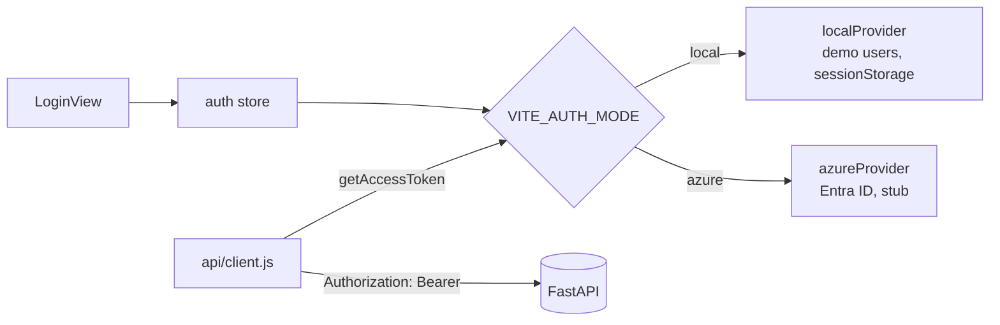

# Frontend

The TechRep Scheduler UI is a Vue 3 single-page app built with Vite. It talks to the FastAPI backend over REST/JSON. For the system view, see [architecture.md](architecture.md).

## Tech stack

| Concern | Library | Notes |
| --- | --- | --- |
| Framework | Vue 3 (`<script setup>`, Composition API) | Single-file components |
| Build and dev server | Vite with `@vitejs/plugin-vue` | Dev server on port 5173; `@` aliases `src/` |
| Routing | Vue Router (HTML5 history mode) | Lazy-loaded routes, role guard in `beforeEach` |
| State | Pinia (setup stores) | `auth`, `reference`, `toast` |
| Animation | GSAP | Home page, login page, schedule run results, timeline bars |
| Styling | Plain CSS | Global tokens and utility classes in `styles/main.css`, scoped styles per component |

There is no UI component library and no HTTP library; the API client wraps `fetch`.

## Directory structure

```text
frontend/
├── .env.example                 VITE_* settings template (copy to .env)
├── .dockerignore                Keeps node_modules, dist, and .env out of the image
├── Dockerfile                   Node 24 LTS build stage, then unprivileged nginx on :8080
├── nginx.conf                   SPA fallback, security headers, /assets caching
├── index.html                   Vite entry HTML
├── package.json                 Scripts: dev, build, preview
├── vite.config.js               Vue plugin, @ alias, dev port
├── public/
│   ├── logo.svg                 Brand logo used by AppLogo
│   └── staticwebapp.config.json Azure Static Web Apps fallback and headers
└── src/
    ├── main.js                  Creates the app, installs Pinia and the router
    ├── App.vue                  Root: navbar or dashboard layout, footer, toasts
    ├── config.js                Reads import.meta.env into a typed config object
    ├── api/
    │   ├── client.js            fetch wrapper: base URL, bearer token, query strings, ApiError
    │   └── index.js             `api` object with one namespace per backend router
    ├── auth/
    │   ├── index.js             Picks the provider from VITE_AUTH_MODE
    │   ├── roles.js             ROLES and hasRole (admin implies scheduler)
    │   ├── localProvider.js     Hardcoded demo users, session in sessionStorage
    │   └── azureProvider.js     Entra ID stub with the same interface and claim mapping
    ├── components/
    │   ├── AppNavbar.vue        Public top bar: logo, page anchors, area links or sign-in
    │   ├── AppLogo.vue          Logo and app name; replace public/logo.svg to rebrand
    │   ├── AppFooter.vue        Footer on public pages
    │   ├── BaseModal.vue        Teleported dialog with Escape and backdrop close, footer slot
    │   ├── PageHeader.vue       Page title, subtitle, and an action slot
    │   ├── ScheduleTimeline.vue Gantt-style view: one row per rep, bars per assignment
    │   ├── StatusBadge.vue      Colored pill for status values
    │   └── ToastHost.vue        Renders toasts from the toast store
    ├── composables/
    │   └── useResource.js       useResource (load + reload) and useSubmit (busy, error, toast)
    ├── layouts/
    │   └── DashboardLayout.vue  Sidebar for the admin or scheduler area; loads reference data
    ├── router/
    │   └── index.js             Routes, role guard, page titles
    ├── stores/
    │   ├── auth.js              Current user, login and logout, home route per role
    │   ├── reference.js         Cached reps, aircraft types, MROs and name lookups
    │   └── toast.js             Success and error notifications
    ├── styles/
    │   └── main.css             Design tokens and shared classes (card, btn, table, grid, stat)
    ├── utils/
    │   └── format.js            Date, number, and text helpers; PATCH diff helper
    └── views/
        ├── HomeView.vue         Public landing page
        ├── LoginView.vue        Sign-in form (local) or SSO button (azure)
        ├── AuthCallbackView.vue Azure redirect target
        ├── NotFoundView.vue     404 page
        ├── admin/
        │   ├── AdminDashboard.vue    Counts, active CBA rules, certification coverage
        │   ├── RepsView.vue          Tech reps and their certifications
        │   ├── AircraftTypesView.vue Aircraft types
        │   ├── MroLocationsView.vue  MRO facilities and travel times per home base
        │   ├── CbaRulesView.vue      CBA rule sets and shift patterns
        │   └── CalendarView.vue      Statutory holidays and pay periods
        └── scheduler/
            ├── SchedulerDashboard.vue Open demand, AOG, leave requests, proposals, this week
            ├── DemandsView.vue        MRO demand and solicitation responses
            ├── UnavailabilityView.vue Leave requests: approve, reject, cancel
            ├── ScheduleRunView.vue    Run the solver for a window and review results
            └── AssignmentsView.vue    Table or timeline; confirm, start, complete, cancel
```

## Routes

| Path | Name | Role | View |
| --- | --- | --- | --- |
| `/` | `home` | Public | `HomeView` |
| `/login` | `login` | Public | `LoginView` |
| `/auth/callback` | `auth-callback` | Public | `AuthCallbackView` |
| `/admin` | `admin` | `admin` | `AdminDashboard` |
| `/admin/reps` | `admin-reps` | `admin` | `RepsView` |
| `/admin/aircraft-types` | `admin-aircraft` | `admin` | `AircraftTypesView` |
| `/admin/mro-locations` | `admin-mro` | `admin` | `MroLocationsView` |
| `/admin/cba-rules` | `admin-cba` | `admin` | `CbaRulesView` |
| `/admin/calendar` | `admin-calendar` | `admin` | `CalendarView` |
| `/scheduler` | `scheduler` | `scheduler` | `SchedulerDashboard` |
| `/scheduler/demands` | `scheduler-demands` | `scheduler` | `DemandsView` |
| `/scheduler/unavailability` | `scheduler-unavailability` | `scheduler` | `UnavailabilityView` |
| `/scheduler/run` | `scheduler-run` | `scheduler` | `ScheduleRunView` |
| `/scheduler/assignments` | `scheduler-assignments` | `scheduler` | `AssignmentsView` |
| anything else | `not-found` | Public | `NotFoundView` |

The `/admin` and `/scheduler` parents use `DashboardLayout` and set `meta.requiresAuth` and `meta.role`. The guard in `router/index.js`:

1. Waits for `auth.init()` to restore the session.
2. Sends signed-in users away from `/login` to their home route.
3. Sends anonymous users to `/login?redirect=<path>`.
4. Sends users without the required role to their home route.

`hasRole` treats `admin` as a superset of `scheduler`, so admins can open every page.

## Authentication



Both providers expose the same interface: `init`, `login`, `logout`, and `getAccessToken`. The API client adds a bearer token only when the provider returns one.

- **local** (default): demo admin and scheduler accounts are hardcoded in `localProvider.js`. They ship in the bundle and are for demos only.
- **azure**: `azureProvider.js` maps Entra ID app roles (`VITE_AZURE_ADMIN_ROLE`, `VITE_AZURE_SCHEDULER_ROLE`) to UI roles. Login and token calls are not implemented yet; the file notes the `@azure/msal-browser` calls to use.

The backend does not validate tokens yet, so UI role checks hide pages but do not protect data.

## Data flow

- **API client** (`api/client.js`): prefixes `VITE_API_BASE_URL`, drops empty query parameters, sends JSON, and throws `ApiError` with the backend `detail` message. A network failure becomes "Cannot reach the API at ...".
- **API surface** (`api/index.js`): `reps`, `aircraftTypes`, `mroLocations`, `cba`, `unavailability`, `demands`, `assignments`, and `schedule` namespaces map one-to-one to backend routers.
- **Reference store**: `DashboardLayout` loads reps, aircraft types, and MROs once. Views use `repName`, `mroName`, and `aircraftName` to turn IDs into labels. Admin views call `reference.load(true)` after saving.
- **useResource**: `const { data, loading, reload } = useResource(() => api.x.list(params))`. It loads on mount and shows a toast on error.
- **useSubmit**: wraps create and update calls with `busy` and `error` state and a success toast. Forms show `error` inline.
- **Edits**: admin forms send only changed fields to `PATCH` endpoints, using `diff()` from `utils/format.js`.
- **Dates**: the backend stores UTC. Forms use `datetime-local` inputs, converted with `toLocalInput` and `toIso`.

## Configuration

Vite inlines every `VITE_*` variable at build time. Anything set here is visible in the browser, so never put secrets in it.

| Variable | Default | Purpose |
| --- | --- | --- |
| `VITE_APP_NAME` | `TechRep Scheduler` | Name in the logo and page titles |
| `VITE_API_BASE_URL` | `http://localhost:8000` | Backend origin; must be in the backend `CORS_ORIGINS` |
| `VITE_AUTH_MODE` | `local` | `local` or `azure` |
| `VITE_AZURE_CLIENT_ID` | | Entra app (SPA) client ID |
| `VITE_AZURE_TENANT_ID` | | Entra tenant ID |
| `VITE_AZURE_AUTHORITY` | | `https://login.microsoftonline.com/<tenant-id>` |
| `VITE_AZURE_REDIRECT_URI` | `<origin>/auth/callback` | Redirect after sign-in |
| `VITE_AZURE_POST_LOGOUT_REDIRECT_URI` | `<origin>` | Redirect after sign-out |
| `VITE_AZURE_API_SCOPE` | | Scope requested for the API token |
| `VITE_AZURE_ADMIN_ROLE` | `TechRep.Admin` | App role mapped to `admin` |
| `VITE_AZURE_SCHEDULER_ROLE` | `TechRep.Scheduler` | App role mapped to `scheduler` |

## Development

```sh
cd frontend
cp .env.example .env
npm install
npm run dev       # http://localhost:5173
npm run build     # output in dist/
npm run preview   # serve dist/ locally
```

From the repository root, `make frontend` starts the dev server and `make dev` runs it together with the backend.

## Deployment

### Docker

```sh
make frontend-docker-build VITE_API_BASE_URL=https://api.example.com
docker run --rm -p 8080:8080 techrep-frontend
```

- **Build stage** (`node:24-alpine`): `npm ci`, then `npm run build`. Every `VITE_*` value is a build argument, because `.env` is excluded from the build context.
- **Serve stage** (`nginxinc/nginx-unprivileged`): runs as a non-root user on port 8080 and serves `dist/` with `nginx.conf`:
  - Unknown paths fall back to `index.html` so client-side routes work on refresh.
  - `/assets/` files are fingerprinted and cached for one year (`immutable`); `index.html` is `no-cache`.
  - Headers: `X-Content-Type-Options`, `X-Frame-Options: DENY`, `Referrer-Policy`, `Permissions-Policy`. A Content-Security-Policy is not set yet; add one once the API and Azure origins are final.

Changing the API URL or auth settings requires rebuilding the image.

### Azure Static Web Apps

Deploy `dist/`. `public/staticwebapp.config.json` is copied into the build and provides the SPA fallback (excluding `/assets/*` and static files) and the same security headers.
