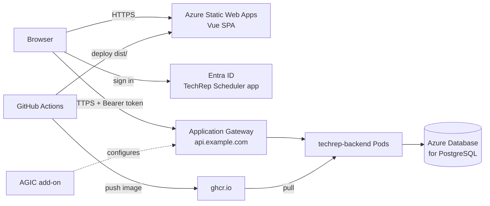

# Hosting

Host the frontend on Azure Static Web Apps, run the backend on AKS, and sign users in with an Entra ID app registration.

## Architecture



| Component | Hosted on | Public URL (example) |
| --- | --- | --- |
| Frontend (Vue SPA) | Azure Static Web Apps | `https://<name>.azurestaticapps.net` |
| Backend (FastAPI) | AKS, namespace `hackathon`, exposed through Application Gateway (AGIC) | `https://api.example.com` |
| Database | Azure Database for PostgreSQL Flexible Server | Private to AKS |
| Identity | Entra ID app registration | `https://login.microsoftonline.com/<tenant-id>` |

Key points:

- The browser calls the API directly through the Application Gateway endpoint. Static Web Apps cannot link an AKS backend, so the API needs its own public HTTPS endpoint and CORS.
- AGIC routes Application Gateway traffic straight to the pod IPs. The `techrep-backend` Service stays `ClusterIP`.
- Sign-in runs in the SPA with MSAL. It does not use the built-in Static Web Apps auth, so the **Free** plan is enough.
- With the frontend on Static Web Apps, the `techrep-frontend` Deployment and Service in `infrastructure/` are not needed.

> **Security:** the backend does not validate tokens yet (see [Next Steps](azure_sso_setup.md#next-steps)). Once the ingress is public, anyone who finds the URL can call the API. Add token validation before exposing real data.

## Prerequisites

- Azure subscription with rights to create resources in a resource group.
- An AKS cluster, or rights to create one.
- A DNS name for the API, for example `api.example.com`, and a TLS certificate (PFX, or PEM cert and key) for that name.
- Admin access to the GitHub repo, to add secrets and variables.
- CLI tools: `az`, `kubectl`.

Set these shell variables. The rest of this guide uses them:

```zsh
RG=rg-techrep
LOCATION=canadacentral
AKS=aks-techrep
SWA=swa-techrep
APPGW=appgw-techrep
API_HOST=api.example.com
```

## 1. App Registration

Follow [azure_sso_setup.md](azure_sso_setup.md) steps 1 to 6. Then come back here to add the Static Web Apps redirect URIs once the host name is known (step 4).

Record:

- **Application (client) ID** -> `CLIENT_ID`
- **Directory (tenant) ID** -> `TENANT_ID`

## 2. Database

The backend needs PostgreSQL that the AKS pods can reach. `localhost` does not work from the cluster.

1. Create an Azure Database for PostgreSQL Flexible Server, ideally with private access in the AKS virtual network.
2. Create the `techrep` database and role.
3. Run the schema as the `techrep` role:
   ```zsh
   psql "host=<server>.postgres.database.azure.com dbname=techrep user=techrep sslmode=require" -f db/init.sql
   ```

## 3. Backend on AKS

### Connect to the Cluster

```zsh
az aks get-credentials -g $RG -n $AKS
kubectl apply -f infrastructure/namespace.yaml
```

### Image Pull Secret

The images live in GHCR. Create the pull secret with a GitHub token that has `read:packages`:

```zsh
kubectl create secret docker-registry ghcr-pull-secret -n hackathon \
  --docker-server=ghcr.io \
  --docker-username=<github-user> \
  --docker-password=<github-token>
```

### Backend Settings

Add the production values to `backend/.env`. `CORS_ORIGINS` must list the Static Web Apps origin, and the value is a JSON list:

```dotenv
DB_HOST=<server>.postgres.database.azure.com
DB_NAME=techrep
DB_USER=techrep
DB_PASSWORD=<password>
CORS_ORIGINS=["https://<name>.azurestaticapps.net"]
```

If you don't know the Static Web Apps host yet, finish section 4 first and come back. Then create or update the secret:

```zsh
kubectl create secret generic techrep-backend-env -n hackathon \
  --from-env-file=backend/.env --dry-run=client -o yaml | kubectl apply -f -
```

Do not commit real values in `infrastructure/secret.yaml`.

### Deploy the Backend

Remove the `techrep-frontend` Deployment from `infrastructure/deployment.yaml` and the `techrep-frontend` Service from `infrastructure/service.yaml`. Then apply:

```zsh
kubectl apply -f infrastructure/deployment.yaml -f infrastructure/service.yaml
kubectl rollout status deployment/techrep-backend -n hackathon
```

Set the `image:` tag to the release tag produced by the `Release` workflow.

### Expose the API Through AGIC

The Application Gateway Ingress Controller (AGIC) add-on turns Kubernetes `Ingress` objects into Application Gateway rules. The gateway's public IP is the API endpoint.

> The SPA is served over HTTPS, so browsers block calls to a plain-HTTP API (mixed content). The gateway needs an HTTPS listener with a certificate for `$API_HOST`.

1. Enable the AGIC add-on. This creates a new Application Gateway (Standard_v2) in its own subnet:
   ```zsh
   az aks enable-addons -g $RG -n $AKS -a ingress-appgw \
     --appgw-name $APPGW --appgw-subnet-cidr "10.225.0.0/16"
   ```
   To use an existing gateway, pass `--appgw-id <gateway-resource-id>` instead of the name and subnet. The subnet must not overlap the AKS virtual network ranges.

2. Store the certificate as a Kubernetes TLS secret. AGIC uploads it to the gateway:
   ```zsh
   kubectl create secret tls techrep-backend-tls -n hackathon \
     --cert=api.example.com.crt --key=api.example.com.key
   ```
   To keep the certificate in Key Vault instead, add it to the gateway with `az network application-gateway ssl-cert create --key-vault-secret-id ...`. Then replace the `tls` block below with the annotation `appgw.ingress.kubernetes.io/appgw-ssl-certificate: <cert-name>`.

3. Create `infrastructure/ingress.yaml`:
   ```yaml
   apiVersion: networking.k8s.io/v1
   kind: Ingress
   metadata:
     name: techrep-backend
     namespace: hackathon
     labels:
       app.kubernetes.io/name: techrep-backend
       app.kubernetes.io/part-of: techrep-scheduler
     annotations:
       appgw.ingress.kubernetes.io/ssl-redirect: "true"
       appgw.ingress.kubernetes.io/health-probe-path: /health
   spec:
     ingressClassName: azure-application-gateway
     tls:
       - hosts: [api.example.com]
         secretName: techrep-backend-tls
     rules:
       - host: api.example.com
         http:
           paths:
             - path: /
               pathType: Prefix
               backend:
                 service:
                   name: techrep-backend
                   port:
                     name: http
   ```

4. Apply it and get the gateway's public IP:
   ```zsh
   kubectl apply -f infrastructure/ingress.yaml
   kubectl get ingress techrep-backend -n hackathon
   ```

5. Create a DNS **A record** for `$API_HOST` that points to the `ADDRESS` from the previous command.

6. Test:
   ```zsh
   curl https://$API_HOST/health
   ```

For extra protection, switch the gateway to the **WAF_v2** SKU and enable the OWASP rule set.

## 4. Frontend on Azure Static Web Apps

### Create the Static Web App

```zsh
az staticwebapp create -g $RG -n $SWA --location eastus2 --sku Free
az staticwebapp show -g $RG -n $SWA --query defaultHostname -o tsv
```

Static Web Apps is only available in a few regions (`eastus2`, `centralus`, `westus2`, `westeurope`, `eastasia`). The content is served globally, so the region only affects where the resource's metadata lives.

The second command prints the host, for example `<name>.azurestaticapps.net`. Use it for:

- `CORS_ORIGINS` in the backend secret (section 3).
- Redirect URIs in the app registration (section 5).

### GitHub Secret and Variables

Get the deployment token and store it as a repo **secret**:

```zsh
az staticwebapp secrets list -g $RG -n $SWA --query properties.apiKey -o tsv
```

| Kind | Name | Value |
| --- | --- | --- |
| Secret | `AZURE_STATIC_WEB_APPS_API_TOKEN` | Token from the command above |
| Variable | `VITE_API_BASE_URL` | `https://api.example.com` |
| Variable | `VITE_AUTH_MODE` | `azure` |
| Variable | `VITE_AZURE_CLIENT_ID` | `CLIENT_ID` |
| Variable | `VITE_AZURE_TENANT_ID` | `TENANT_ID` |
| Variable | `VITE_AZURE_AUTHORITY` | `https://login.microsoftonline.com/<TENANT_ID>` |
| Variable | `VITE_AZURE_REDIRECT_URI` | `https://<name>.azurestaticapps.net/auth/callback` |
| Variable | `VITE_AZURE_POST_LOGOUT_REDIRECT_URI` | `https://<name>.azurestaticapps.net/` |
| Variable | `VITE_AZURE_API_SCOPE` | `api://<CLIENT_ID>/access_as_user` |

The `VITE_*` values are not secrets. Vite bakes them into the browser bundle. The existing `frontend-build.yaml` workflow reads the same variables.

### Deploy Workflow

Create `.github/workflows/frontend-swa.yaml`:

```yaml
name: Frontend (Static Web Apps)

on:
  push:
    branches: [main]
    paths:
      - "frontend/**"
      - ".github/workflows/frontend-swa.yaml"
  workflow_dispatch:

permissions:
  contents: read

jobs:
  deploy:
    runs-on: ubuntu-latest
    steps:
      - uses: actions/checkout@v4

      - uses: actions/setup-node@v4
        with:
          node-version: 20
          cache: npm
          cache-dependency-path: frontend/package-lock.json

      - name: Build
        working-directory: frontend
        run: npm ci && npm run build
        env:
          VITE_APP_NAME: ${{ vars.VITE_APP_NAME }}
          VITE_API_BASE_URL: ${{ vars.VITE_API_BASE_URL }}
          VITE_AUTH_MODE: ${{ vars.VITE_AUTH_MODE }}
          VITE_AZURE_CLIENT_ID: ${{ vars.VITE_AZURE_CLIENT_ID }}
          VITE_AZURE_TENANT_ID: ${{ vars.VITE_AZURE_TENANT_ID }}
          VITE_AZURE_AUTHORITY: ${{ vars.VITE_AZURE_AUTHORITY }}
          VITE_AZURE_REDIRECT_URI: ${{ vars.VITE_AZURE_REDIRECT_URI }}
          VITE_AZURE_POST_LOGOUT_REDIRECT_URI: ${{ vars.VITE_AZURE_POST_LOGOUT_REDIRECT_URI }}
          VITE_AZURE_API_SCOPE: ${{ vars.VITE_AZURE_API_SCOPE }}

      - name: Deploy
        uses: Azure/static-web-apps-deploy@v1
        with:
          azure_static_web_apps_api_token: ${{ secrets.AZURE_STATIC_WEB_APPS_API_TOKEN }}
          action: upload
          app_location: frontend/dist
          skip_app_build: true
          skip_api_build: true
```

The workflow builds the app itself and uploads `frontend/dist`. `frontend/public/staticwebapp.config.json` is copied into `dist`. It handles the page fallback (so `/admin` loads on refresh) and sets the security headers.

The workflow deploys only on pushes to `main`. Pull request previews get a new host name each time, and Entra ID does not accept wildcard redirect URIs, so sign-in would fail on those previews.

### Custom Domain (Optional)

```zsh
az staticwebapp hostname set -g $RG -n $SWA --hostname app.example.com
```

Create the CNAME record shown in the portal. Static Web Apps issues the certificate. If you add a custom domain, update `CORS_ORIGINS`, the `VITE_AZURE_*_URI` variables, and the redirect URIs to use it.

## 5. Connect the Pieces

These values must match exactly, including scheme and trailing slash.

| Setting | Where | Value |
| --- | --- | --- |
| SPA redirect URI | App registration > Authentication > Single-page application | `https://<name>.azurestaticapps.net/auth/callback` |
| Front-channel logout URL | App registration > Authentication | `https://<name>.azurestaticapps.net/` |
| `VITE_AZURE_REDIRECT_URI` | GitHub variable | Same as the SPA redirect URI |
| `VITE_AZURE_POST_LOGOUT_REDIRECT_URI` | GitHub variable | `https://<name>.azurestaticapps.net/` |
| `CORS_ORIGINS` | `techrep-backend-env` secret | `["https://<name>.azurestaticapps.net"]` |
| `VITE_API_BASE_URL` | GitHub variable | `https://api.example.com` |
| Ingress host and TLS host | `infrastructure/ingress.yaml` | `api.example.com` |
| TLS certificate subject | `techrep-backend-tls` secret | `api.example.com` |

After changing the backend secret, restart the pods so they pick it up:

```zsh
kubectl rollout restart deployment/techrep-backend -n hackathon
```

After changing a `VITE_*` variable, rerun the `Frontend (Static Web Apps)` workflow.

## 6. Verify

1. `curl https://api.example.com/health` returns `200`.
2. Open `https://<name>.azurestaticapps.net` and select **Sign in**. Entra ID redirects you to Microsoft sign-in.
3. After sign-in, admins land on `/admin` and schedulers land on `/scheduler`.
4. Refresh on `/admin/reps`. The page loads instead of showing a 404.
5. In the browser dev tools Network tab, API calls go to `https://api.example.com` with an `Authorization: Bearer` header and no CORS errors.
6. A user without a role is blocked with `AADSTS50105`.

## Troubleshooting

| Symptom | Cause | Fix |
| --- | --- | --- |
| CORS error in the browser console | Static Web Apps origin is missing from `CORS_ORIGINS` | Update the secret and restart the backend |
| "Mixed content" blocked | `VITE_API_BASE_URL` uses `http://` | Use the HTTPS ingress host and rerun the workflow |
| `Cannot reach the API at ...` | DNS not set or ingress has no address | Check `kubectl get ingress -n hackathon` and the DNS A record |
| `502 Bad Gateway` from the gateway | Backend pods unhealthy or the health probe fails | Check **Application Gateway > Backend health** in the portal and `kubectl get pods -n hackathon` |
| Ingress changes not applied | AGIC cannot update the gateway | `kubectl logs -n kube-system -l app=ingress-appgw` |
| Certificate error in the browser | Certificate does not match `$API_HOST` or is missing the chain | Recreate `techrep-backend-tls` with the full chain |
| `AADSTS50011` redirect mismatch | Static Web Apps host not registered | Add the exact URI under **Single-page application** |
| 404 on page refresh | `staticwebapp.config.json` missing from `dist` | Confirm it is in `frontend/public/` and the workflow uploads `frontend/dist` |
| Old settings after a deploy | `VITE_*` values are fixed at build time | Rerun the frontend workflow |
| `ImagePullBackOff` on the backend | Pull secret missing or token expired | Recreate `ghcr-pull-secret` |
| Backend `CrashLoopBackOff` | Database unreachable or wrong credentials | `kubectl logs deploy/techrep-backend -n hackathon` and check the `DB_*` values |
